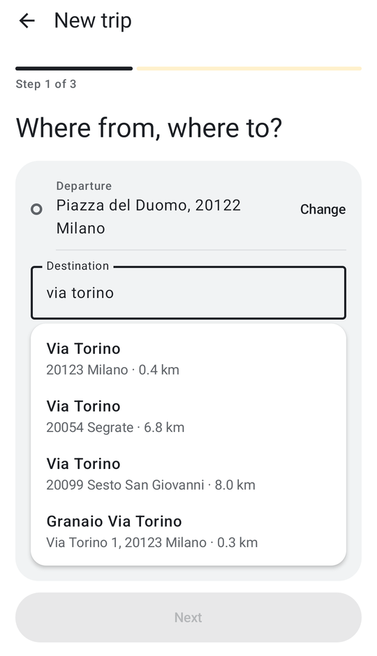
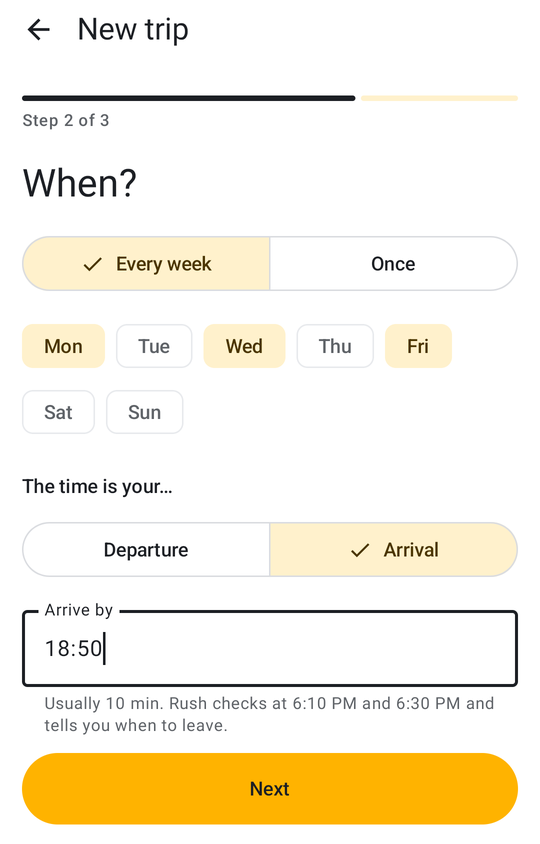

# Rush

A personal Android app that checks your commutes before you leave. For each trip you save (for example
"Gym", Mon/Wed/Fri 17:20) it asks TomTom for the live-traffic travel time at the chosen time and sends a
notification with the time, the delay and any jams on the way.
No backend: just AlarmManager, WorkManager and DataStore.

<p align="center">
  
  &nbsp;
  
  &nbsp;
  
</p>

<p align="center">
  
  &nbsp;
  
</p>

<p align="center">
  
</p>

The UI is in English and Italian, following the device language.

## Features

- **Several trips**: each with its own name, places, days, time and threshold, and its own exact alarm;
  alarms survive reboots, time zone and clock changes. Two trips cannot share a minute on the same day.
- **One-off trips**: an appointment on a given date and time, checked once and then removed on its own.
- **Arrival time**: instead of when to check, say when you want to be there ("at the gym by 18:50"). Rush
  estimates the usual duration, checks live traffic 30 and 10 minutes before you usually leave, and tells you
  when to go: "Gym: leave by 18:14".
- **Home**: the trip with a recent problem (or the next one to be checked) in front, the others one chip away;
  a notification opens its own trip.
- **Live traffic**: travel time, delay and traffic sections (jams, road works, closures) from the TomTom
  Routing API. The time is colored by traffic level: green, orange, red.
- **Threshold**: notify only when traffic adds at least N minutes (0 = always). A failed check always notifies; "Check now"
  never does, its result shows in the app or the widget.
- **Widget**: a home-screen widget (2x1 to 4x2) with one trip's last result, colored like the Home, and a
  "Check now" button. It never calls TomTom itself, and an old result is shown faded with its time.
- **Address suggestions**: places are picked from suggestions while you type, each with its distance; once one
  place is set, the other one prefers results within 50 km of it, so a bare street name finds the one in your city.
- **Guided setup**: a new trip is three short steps (where, when, alerts); editing a trip stays on one screen.
- **System warnings**: if notifications, background running or exact alarms are not allowed, Home shows a
  warning with a one-tap fix; it disappears as soon as the setting is fixed.

## TomTom key

1. Sign up at <https://developer.tomtom.com> (free plan, no card required; about 2,500 requests/day).
2. Dashboard → **API & SDK Keys** → *Create key*, enable **Routing API** and **Search API**.
3. Add it to `local.properties` in the project root (already ignored by git):

   ```properties
   TOMTOM_API_KEY=your_key
   ```
4. Rebuild: the key ends up in `BuildConfig.TOMTOM_API_KEY`.

## Build and install

Open the folder in Android Studio and press Run, or:

```sh
./gradlew installDebug      # phone connected with USB debugging (or wireless debugging) enabled
./gradlew testDebugUnitTest # unit tests
```

On first launch: allow notifications and tap **Add trip**: three steps. Type the departure and the destination
and pick each from the suggestions, then pick days and the time (departure or arrival), then when to be told,
and **Save trip**. More trips, and
edits, are under the gear. If Home asks to let Rush run in the background, tap **Allow**.

## Testing without waiting

```sh
PKG=io.github.roby222.rush

# scheduled alarms, one "origWhen" per trip
adb shell dumpsys alarm | grep -A1 "walarm\*:$PKG.CHECK"

# run trip 1's check now, as if its alarm fired, and reschedule every trip
adb shell am broadcast -n $PKG/.work.AlarmReceiver -a $PKG.CHECK --ei trip 1

# reschedule only, as after a reboot (recent Android refuses BOOT_COMPLETED from the shell)
adb shell am broadcast -n $PKG/.work.AlarmReceiver -a $PKG.RESCHEDULE

# WorkManager job state
adb shell dumpsys jobscheduler | grep -A6 $PKG

# simulate Doze: the alarm must still fire
adb shell dumpsys deviceidle force-idle
adb shell dumpsys deviceidle unforce

# logs
adb logcat | grep -iE "rush|WM-"
```

To check a real trigger: edit a trip, set its time 2 minutes from now and include today among the days.

Every trip has its own WorkManager queues, scheduled and manual: "Check now" never cancels a scheduled
check, no trip cancels another, and repeated taps run a single manual check.

## Structure

Packages follow Android's [app architecture guide](https://developer.android.com/topic/architecture):
a UI layer (Compose screens and ViewModels, one package per screen), a data layer (`TripRepository` over
local and remote sources), and a domain layer of pure rules covered by unit tests.

| Package | What it holds |
|---------|---------------|
| `ui/` | `RushApp` (shell, Home → Trips → Editor, system Back), `MainViewModel` (app state, warnings, check now) |
| `ui/home`, `ui/trips`, `ui/editor` | the three screens; the editor's ViewModel with the draft and its validation |
| `ui/components`, `ui/theme` | verdict card, route list, buttons; colors, shapes and the palette shared with the widget |
| `data/` | `TripRepository`: the UI's only door to trips, checks and search; saving a trip reschedules its alarm |
| `data/local` | `TripStore.kt`: DataStore with trips (JSON) and the last result per trip |
| `data/remote` | `TomTom.kt`: Search/Routing calls, JSON models, route → `Check` with slowdowns by street |
| `domain/` | pure rules: next check, one alarm per trip, time clashes, featured trip (`Schedule.kt`); check outcome and when to notify (`CheckOutcome.kt`) |
| `model/` | `Trip`, `Place`, `TripResult`, `Check`, `TrafficEvent`, traffic level |
| `work/` | `Scheduler` (exact alarms, WorkManager queues), `AlarmReceiver`, `CheckWorker` (checks one trip, saves, notifies) |
| `notification/` | the traffic notification and its words, shared with the Home |
| `widget/` | home-screen widget (Glance) and its trip picker |

`MainActivity` hosts the UI and opens the trip of a tapped notification. Tests mirror the packages under
`app/src/test`; shared fixtures live in `TestData.kt`.

Times follow the phone's time zone. The app is meant for sideloading: it uses `USE_EXACT_ALARM` and asks for
the battery optimization exemption directly, both of which Google Play restricts.
