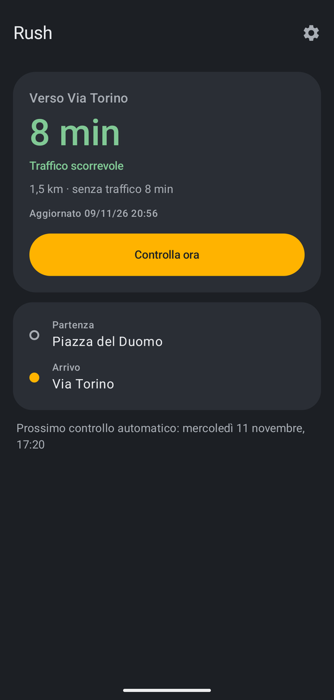
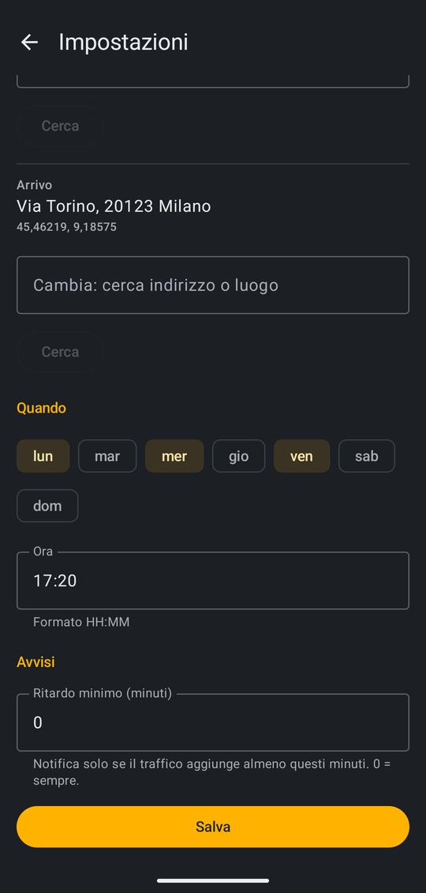

# Rush

A personal Android app that checks your commute before you leave. On the days and at the time you pick
(default Mon/Wed/Fri 17:20) it asks TomTom for the live-traffic travel time between two places and sends a
notification with the time, the delay and any jams on the way.
No backend: just AlarmManager, WorkManager and DataStore.

<p align="center">
  
  &nbsp;&nbsp;
  
</p>

The UI is in Italian.

## Features

- **Scheduled check**: an exact alarm at the chosen time, on the chosen days; survives reboots, time zone
  and clock changes.
- **Live traffic**: travel time, delay and traffic sections (jams, road works, closures) from the TomTom
  Routing API. The time is colored by traffic level: green, orange, red.
- **Threshold**: notify only when traffic adds at least N minutes (0 = always). "Controlla ora" (check now)
  and errors always notify.
- **Local search**: once one place is saved, searching for the other one prefers results within 50 km of it,
  so a bare street name finds the one in your city.
- **System warnings**: if notifications, background running or exact alarms are not allowed, Home shows a
  warning with a one-tap fix; it disappears as soon as the setting is fixed.

## TomTom key

1. Sign up at <https://developer.tomtom.com> (free plan, no card required; about 2,500 requests/day).
2. Dashboard → **API & SDK Keys** → *Create key*, enable **Routing API** and **Search API**.
3. Add it to `local.properties` in the project root (already ignored by git):

   ```properties
   TOMTOM_API_KEY=your_key
   ```
4. Rebuild: the key ends up in `BuildConfig.TOMTOM_API_KEY`.

## Build and install

Open the folder in Android Studio and press Run, or:

```sh
./gradlew installDebug      # phone connected with USB debugging (or wireless debugging) enabled
./gradlew testDebugUnitTest # unit tests
```

On first launch: allow notifications, open **Impostazioni** (the gear), search for the departure and the
destination, check the result and tap **Conferma**. Coordinates are saved once. If Home asks to let Rush run
in the background, tap **Consenti**.

## Testing without waiting

```sh
PKG=io.github.roby222.rush

# scheduled alarm (look for "RTC_WAKEUP" and "origWhen")
adb shell dumpsys alarm | grep -A4 $PKG

# run the check now, as if the alarm fired, and schedule the next one
adb shell am broadcast -n $PKG/.AlarmReceiver -a $PKG.CHECK

# simulate a reboot (reschedule only)
adb shell am broadcast -n $PKG/.AlarmReceiver -a android.intent.action.BOOT_COMPLETED

# WorkManager job state
adb shell dumpsys jobscheduler | grep -A6 $PKG

# simulate Doze: the alarm must still fire
adb shell dumpsys deviceidle force-idle
adb shell dumpsys deviceidle unforce

# logs
adb logcat | grep -iE "rush|WM-"
```

To check a real trigger: in Settings set the time 2 minutes from now and include today among the days.

Scheduled and manual checks run in separate WorkManager queues: "Controlla ora" never cancels a scheduled
check, and repeated taps run a single manual check.

## Structure

| File | What it does |
|------|--------------|
| `TomTom.kt` | Search/Routing calls, JSON models, notification text, traffic level |
| `CheckWorker.kt` | expedited worker: computes the check outcome, saves it, notifies |
| `Scheduler.kt` | next trigger, `AlarmManager`, receiver for alarm/boot/time change |
| `Prefs.kt` | DataStore: places, days, time, threshold, last result |
| `MainActivity.kt` | Home and Settings screens (Compose) |
| `Theme.kt` | colors and shapes: graphite/white surfaces, amber accent, traffic colors |

Times follow the phone's time zone. The app is meant for sideloading: it uses `USE_EXACT_ALARM` and asks for
the battery optimization exemption directly, both of which Google Play restricts.

## Claude Code

`.claude/skills/` contains a few of the official [Android skills](https://github.com/android/skills)
(Apache-2.0) used while developing the app.
